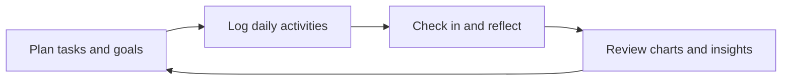
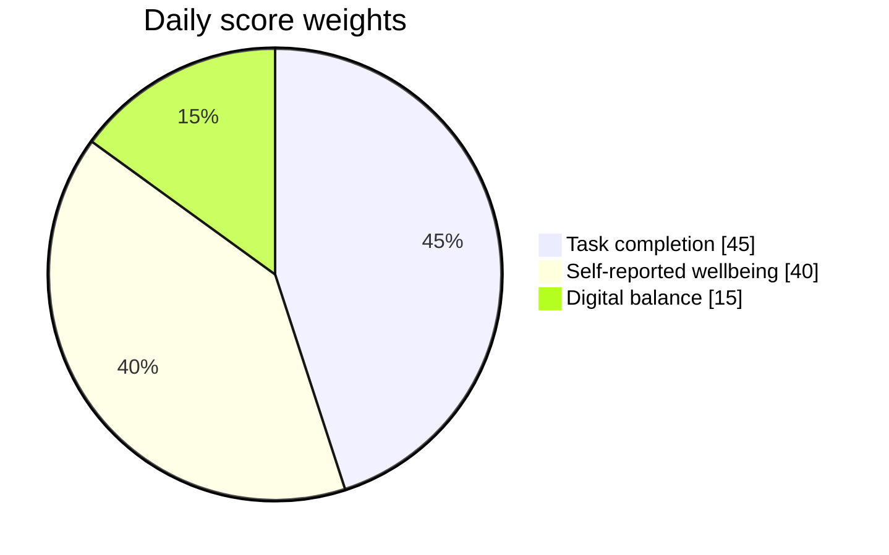
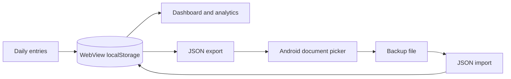
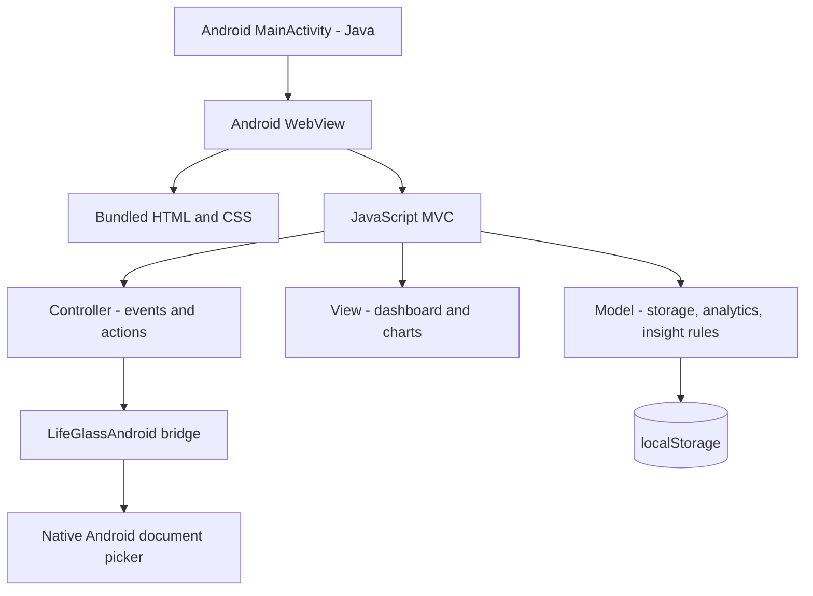
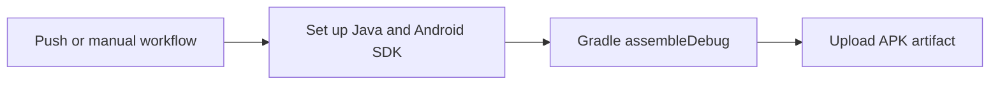

<div align="center">

# Life Mirror · LifeGlass

**Track your day. Understand your patterns. Improve with intention.**

An offline-first personal productivity and self-monitoring Android application.

    

[Features](#explore-the-app) · [Architecture](#under-the-hood) · [Build APK](#build-and-install) · [Data](#data-ownership)

</div>

## A personal feedback loop

LifeGlass brings tasks, goals, daily check-ins, screen-time logs and reflections into one dashboard. Instead of treating productivity as task completion alone, it combines several signals into a personal review.



## Explore the app

| Today | Goals | Analytics |
| :--- | :--- | :--- |
| Daily score ring, task list, activity timeline and check-ins | Goal cards, categories and adjustable progress | Progress lines, screen-time trends and activity heatmap |
| **Journal** | **Settings** | **Appearance** |
| Daily reflection and quick notes | Profile, screen-time target, JSON backup and restore | Glassmorphism interface with light and dark themes |

### 01 · Daily dashboard

A single view connects task completion, goals, mood, energy, satisfaction and manually logged screen time. Add tasks, assign priorities and mark them complete; record activities and digital usage by category.

### 02 · Personal analytics



The JavaScript model calculates a weighted daily score and aggregates recorded days across weekly, monthly and yearly views. The dashboard displays charts, check-in averages, activity streaks and rule-based insights. This score is a personal tracking heuristic, not a clinical or validated wellbeing measure.

### 03 · Goals and reflection

Set goals, adjust progress and review the day through three prompts: what worked, what could improve, and what to change tomorrow. Quick notes provide space for additional thoughts.

### 04 · Offline and portable



All dashboard resources, including photography, are bundled in the APK. No server or internet connection is required for core functionality. Screen time is entered manually; the app does not monitor Android usage automatically.

## Under the hood



| Layer | Implementation |
| --- | --- |
| Native shell | Java, Android SDK, WebView |
| Interface | HTML5, CSS3, JavaScript, Canvas charts, inline SVG icons |
| Application logic | Model, View, Controller and rule-based InsightEngine |
| Persistence | localStorage and JSON import/export |
| Build | Gradle and GitHub Actions |

## Build and install

**Requirements:** Android Studio with compatible Gradle/JDK tooling, Android SDK 36. Minimum device version: Android 8.0 (API 26). The repository specifies Android Gradle Plugin 9.3.0, Gradle 9.5.0 in CI, and SDK 36.

1. Open the repository folder in Android Studio and sync Gradle.
2. Install the required SDK if prompted.
3. Build a debug APK using Android Studio or a compatible installed Gradle distribution:

```bash
gradle assembleDebug
```

APK output: `app/build/outputs/apk/debug/app-debug.apk`.

### GitHub Actions



Open **Actions → Build Android APK → Run workflow** and download `LifeGlass-debug-apk` after a successful build. The workflow is included in the source; this documentation does not assert that the current build has been tested.

### Preview the web interface

From the repository root:

```bash
python -m http.server 8000 --directory app/src/main/assets/lifeglass
```

Visit `http://localhost:8000`. Browser preview does not exercise the native Android bridge.

## Project structure

```text
Life_Mirror/
├── .github/workflows/build-apk.yml
├── app/
│   ├── build.gradle
│   └── src/main/
│       ├── AndroidManifest.xml
│       ├── java/com/lifeglass/tracker/MainActivity.java
│       ├── assets/lifeglass/
│       │   ├── index.html
│       │   ├── css/styles.css
│       │   ├── img/
│       │   └── js/
│       │       ├── app.js
│       │       ├── model.js
│       │       ├── view.js
│       │       └── controller.js
│       └── res/
├── build.gradle
├── gradle.properties
└── settings.gradle
```

## Data ownership

The app stores records locally in Android WebView. Clearing app storage or uninstalling may remove records. Export JSON periodically and keep it somewhere safe. First launch includes 13 days of demonstration history and sample goals; these are not real user measurements. Reset restores the default demonstration data.

Photo credits: d c (workspace), Kelly Sikkema (journal), Vikas Gurjar (sunrise), sourced from Unsplash.

---

<div align="center">

**LifeGlass — A clearer view of everyday progress.**

</div>
