<div align="center">

# 🪞 LifeGlass

### Your Life. Your Data. Your Direction.

An offline-first Android application for personal productivity, self-reflection, goal management and data-driven personal growth.


[Overview](#overview) • [App Showcase](#app-showcase) • [Architecture](#system-architecture) • [Installation](#installation)

<br>

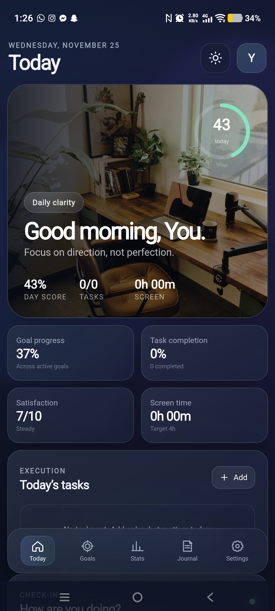
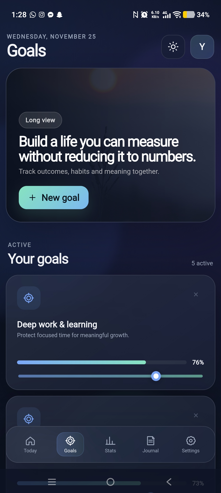
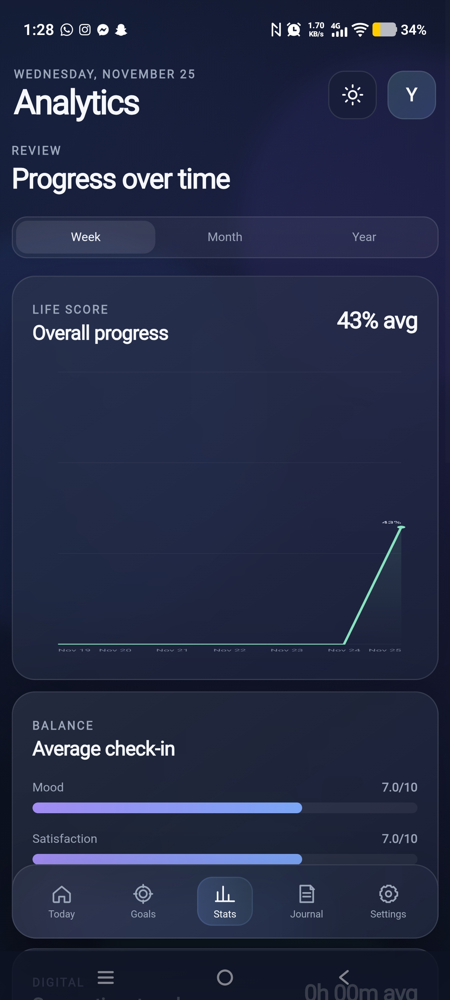

<br>

*Focus on direction, not perfection.*

</div>

---

## Overview

LifeGlass is a personal productivity and self-analytics application designed to help users understand how they spend their time, manage goals, track daily activities and reflect on their personal growth.

Rather than functioning as a conventional to-do list, LifeGlass connects daily actions, emotional wellbeing, digital habits and long-term objectives into a unified personal monitoring experience.

The application follows an offline-first approach, keeping personal records locally accessible without requiring an external database or cloud account.

---

## App Showcase

### 01 — Daily Dashboard & Activity Tracking

<div align="center">

| Daily Dashboard | Daily Check-in | Digital Balance |
|:---:|:---:|:---:|
|  | 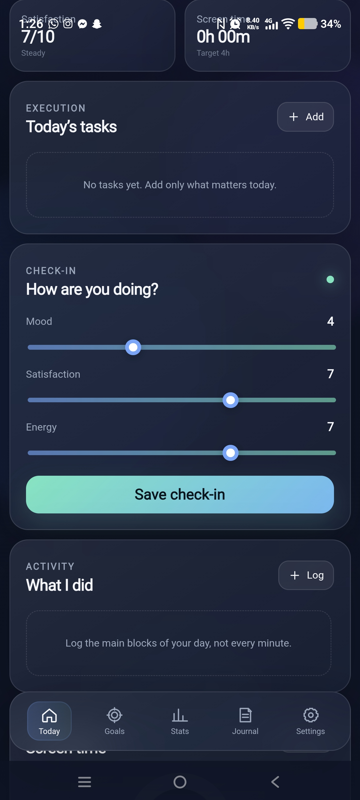 | 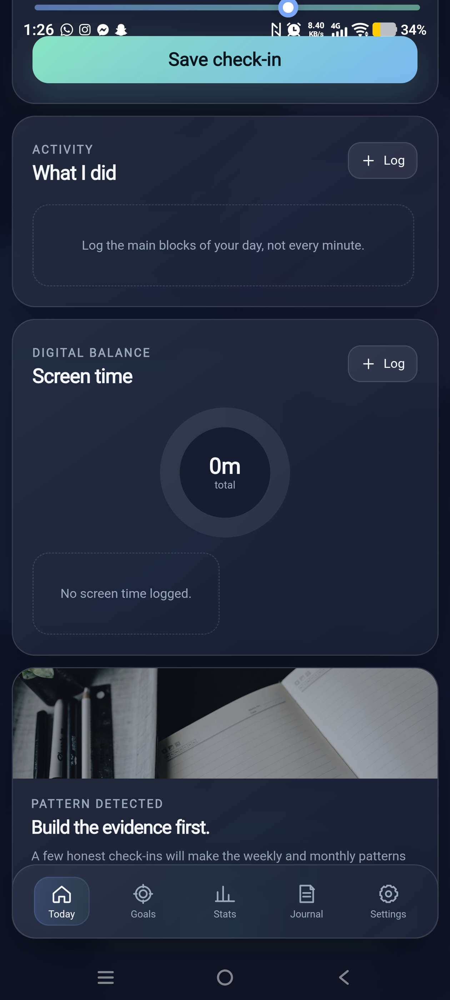 |
| Daily performance overview | Mood, satisfaction and energy | Activity and screen-time logging |

</div>

The daily dashboard provides a consolidated view of personal performance through:

- Dynamic daily life score
- Task creation and completion tracking
- Overall goal progress
- Mood, satisfaction and energy check-ins
- Daily activity logging
- Manual screen-time tracking
- Personalized behavioral insights

---

### 02 — Goal Management

<div align="center">

| Goal Dashboard | Interactive Progress Tracking |
|:---:|:---:|
|  | 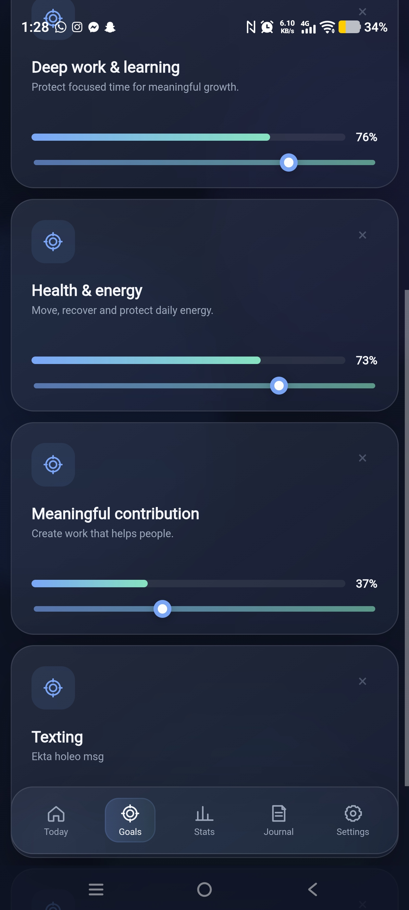 |

</div>

Create meaningful goals and monitor their progress through interactive visual controls.

- Custom goal creation
- Adjustable progress indicators
- Individual goal completion percentages
- Aggregated goal progress
- Dynamic progress visualization

> Build a life you can measure without reducing it to numbers.

---

### 03 — Personal Analytics & Data Visualization

<div align="center">

| Overall Progress | Personal Wellbeing | Activity Heatmap |
|:---:|:---:|:---:|
|  | 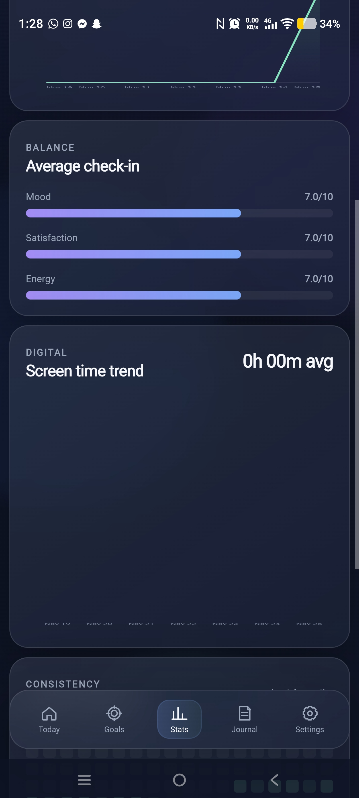 | 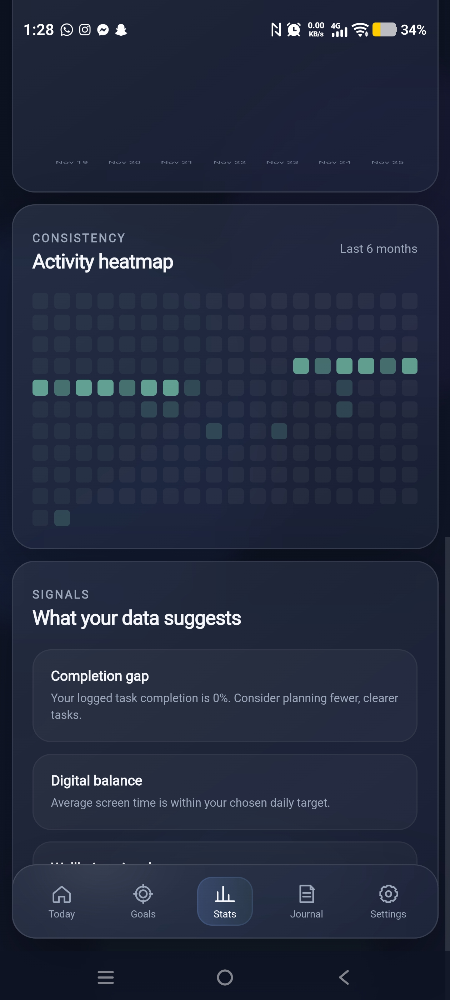 |
| Performance trends | Wellbeing indicators | Consistency and behavioral signals |

</div>

The analytics module transforms recorded personal activities into meaningful visual insights.

- Weekly, monthly and yearly analytics
- Life score trend visualization
- Average mood, satisfaction and energy
- Screen-time trend analysis
- Six-month activity consistency heatmap
- Rule-based behavioral insights
- Task completion and digital balance analysis

---

### 04 — Digital Journal & Self-Reflection

<div align="center">

| Personal Journal | Structured Daily Reflection |
|:---:|:---:|
| 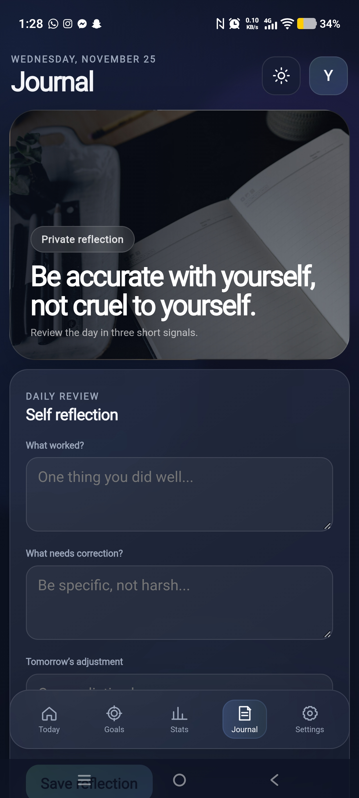 | 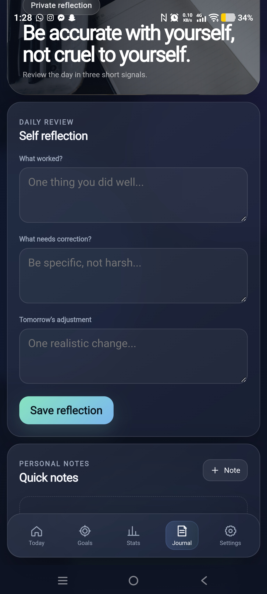 |

</div>

A dedicated space for reviewing daily experiences and identifying realistic improvements.

The reflection system focuses on three questions:

1. What worked today?
2. What needs correction?
3. What adjustment can be made tomorrow?

Users can also maintain personal notes alongside their daily reflections.

> Be accurate with yourself, not cruel to yourself.

---

### 05 — Personalization & Data Ownership

<div align="center">

| Light Mode & Settings | Backup & Data Management |
|:---:|:---:|
| 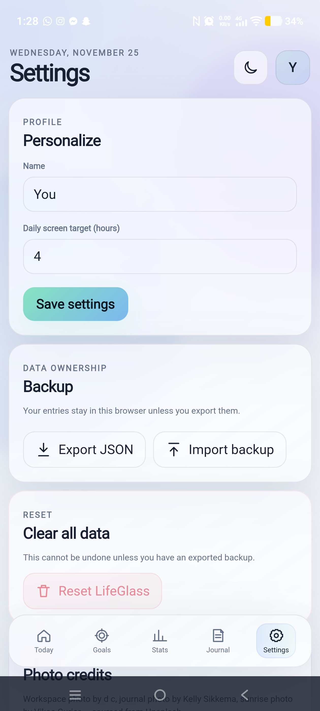 | 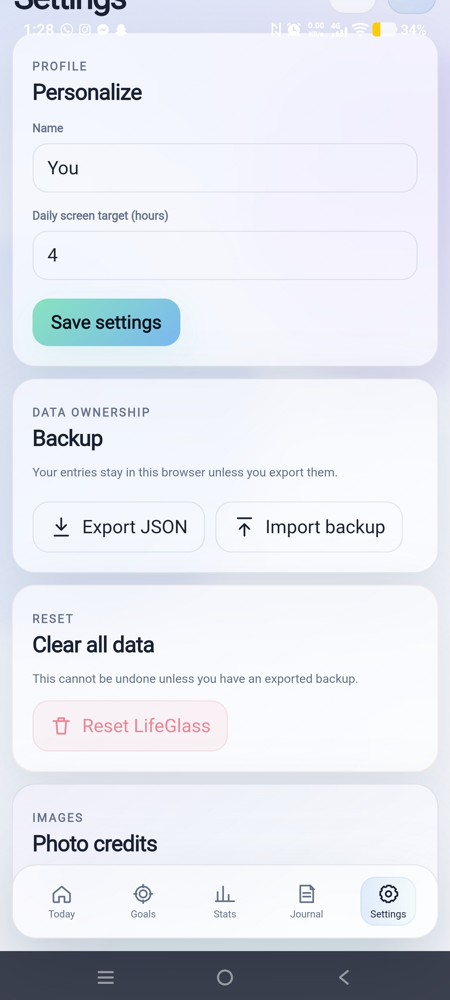 |

</div>

LifeGlass prioritizes local data ownership and personal customization.

- Dark and light theme switching
- Personalized user profile
- Configurable daily screen-time target
- Local data persistence
- JSON backup export
- Backup import and restoration
- Native Android file picker integration
- Complete data reset option

---

## Daily Workflow

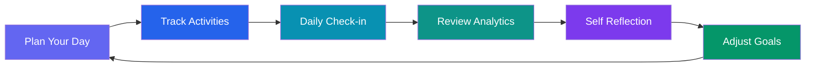

LifeGlass creates a continuous feedback loop between planning, execution, observation and improvement.

---

## Life Score Engine

The application combines multiple personal indicators into a weighted daily performance score.

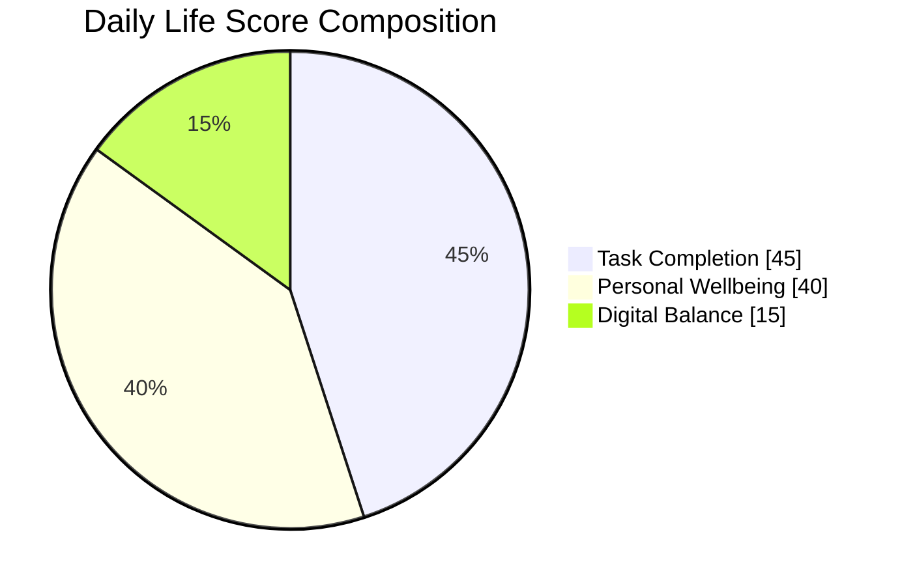

| Component | Weight | Purpose |
|---|:---:|---|
| Task Completion | 45% | Measures daily task execution |
| Personal Wellbeing | 40% | Combines mood, energy and satisfaction |
| Digital Balance | 15% | Evaluates logged screen time against the daily target |

The score provides a simplified personal feedback indicator rather than a clinical or psychological assessment.

---

## System Architecture

LifeGlass uses a hybrid Android architecture, combining native Android functionality with a lightweight web-based application layer.

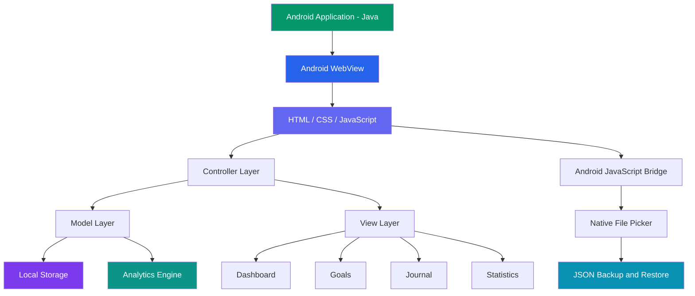

### MVC Architecture

| Layer | Responsibility |
|---|---|
| Model | Data management, persistence and calculations |
| View | Interface rendering and data visualization |
| Controller | User interactions and application state |
| Native Android Layer | WebView integration and native file operations |

---

## Engineering Decisions

### Offline-First Architecture

Personal records are stored locally instead of depending on a remote server. Core functionality does not require continuous internet access or user authentication.

### Native Android Integration

The application combines a Java-based Android layer with an interactive web interface through Android WebView and a JavaScript bridge.

### Data-Driven Personal Insights

Logged activities and daily check-ins are processed into performance scores, statistical summaries, trend charts and consistency visualizations.

### Privacy-Oriented Data Management

Users control their personal records through local persistence and portable JSON backups.

### Lightweight Application Design

The interface is built using core web technologies, avoiding the overhead of large frontend frameworks.

---

## Technology Stack

| Technology | Application |
|---|---|
| Java | Native Android application |
| Android SDK | Android platform integration |
| Android WebView | Hybrid application rendering |
| JavaScript | Application logic and analytics |
| HTML5 | Interface structure |
| CSS3 | Responsive styling and glassmorphism |
| Local Storage | Offline data persistence |
| JSON | Backup and data portability |
| Gradle | Android build management |
| GitHub Actions | Automated APK build workflow |

---

## Installation

### Option 1 — Android APK

If an APK is available under the repository's Releases or GitHub Actions artifacts:

1. Download the APK.
2. Allow installation from the relevant source in Android settings.
3. Install LifeGlass.
4. Launch the application and personalize your profile.

### Option 2 — Build from Source

Clone the repository:

```bash
git clone https://github.com/arafat-rahman-lisan/Life_Mirror.git
```

Open the project in Android Studio.

- Configure the Android SDK.
- Synchronize Gradle dependencies.
- Connect an Android device or launch an emulator.
- Build and run the application.

---

## Automated Build Workflow

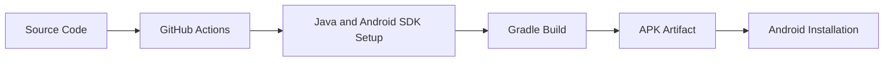

The repository includes a GitHub Actions workflow for automated Android APK generation.

---

## Future Development

- Automatic Android screen-time integration
- Reminder and notification system
- Advanced habit correlation analysis
- Optional encrypted backup
- Home screen widgets
- Enhanced accessibility
- Optional cross-device synchronization

These features represent potential future improvements rather than existing functionality.

---

## Developer

**Arafat Rahman**

Computer Science & Engineering

GitHub: [arafat-rahman-lisan](https://github.com/arafat-rahman-lisan)

---

<div align="center">

## LifeGlass

### Track. Reflect. Understand. Improve.

*Personal growth begins with personal awareness.*

If you find this project interesting, consider giving the repository a ⭐

</div>
